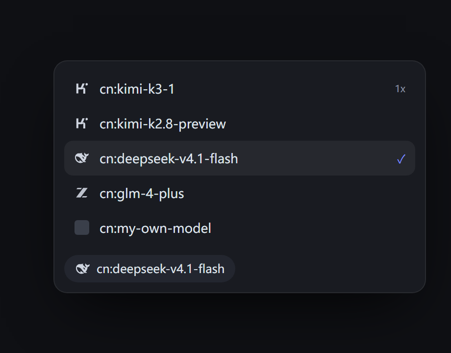

# WorkBuddy 模型图标

给 WorkBuddy 的自定义模型自动配品牌图标。模型名里带 `kimi`、`deepseek` 这类关键词，
菜单里就显示对应的 logo，不用手动挑图。

非官方 mod，和 WorkBuddy、腾讯都没关系。它通过运行时注入改界面，可能违反服务条款，
用不用自己判断。



## 安装

需要 WorkBuddy 5.9.2 或更新。

1. 下载 Release 的 zip，解压到随便哪个目录
2. 双击 `install.cmd`
3. 托盘右键完全退出 WorkBuddy
4. 用原来的图标启动，桌面、开始菜单、任务栏都行

装完打开模型菜单就能看到。

安装器会**接管官方快捷方式**：把 `WorkBuddy.lnk` 改成先跑注入器再启动客户端。
原文件备份成 `WorkBuddy.lnk.wbmods.bak`，图标和名字都不变。

不想被接管就加 `-KeepOfficialIcon`，那样只能从新出现的「WorkBuddy (mods)」启动。

启动时可能闪过一个最小化的窗口，那是注入器，跑完就退。

### 路径不用自己填

装在哪个盘、目录叫什么、有没有中文和空格都不影响。安装器会依次试：

- 上次安装时记下的路径
- 正在运行的进程
- 注册表卸载项（`DisplayIcon`、`InstallLocation`、`UninstallString`）
- App Paths
- 桌面、公共桌面、开始菜单、任务栏固定项的快捷方式
- 默认安装位置

只要目录里有 `resources\app.asar` 就当作客户端。快捷方式不看文件名，
看目标或图标是不是指向 `WorkBuddy.exe`。

全落空会报错，用 `install.cmd -AppRoot "D:\你的路径\WorkBuddy"` 指定一次即可。

### 升级或移动之后

- 快捷方式指向 `%LOCALAPPDATA%\WbMods\node.exe`，这是客户端自带 node 的硬链接，
  不额外占空间。客户端升级换掉版本目录，图标也不会失效。
- 注入器找不到客户端时，会按 `config.json` 里存的候选路径逐个试。

## 支持的品牌

| 关键词（不区分大小写） | 图标 |
|---|---|
| `kimi` / `moonshot` | Kimi |
| `deepseek` | DeepSeek |
| `glm` / `chatglm` / `zhipu` | 智谱 GLM |
| `minimax` / `abab` | MiniMax |
| `hunyuan` / `hy` | 腾讯混元 |
| `claude` / `anthropic` | Claude |
| `gemini` | Gemini |
| `gpt` / `openai` | OpenAI |

匹配不看类名前缀，`cr-`、`wb-` 或以后换成别的都行：只要类名以
`-model-selector__item`、`__item-name`、`__item-icon` 结尾就能识别。

没匹配到的模型保持官方默认图标。找不到结构就不动 DOM。

## 卸载

双击 `uninstall.cmd`。会删掉自己这份 mod，并把接管过的快捷方式还原。

`install.cmd -Status` 可以看当前状态。

## 工作原理

```
快捷方式 → node.exe injector.js
             ├─ 带 --inspect=<随机端口> 启动 WorkBuddy
             ├─ 连上主进程 inspector，注入一段 bootstrap
             ├─ bootstrap 挂 web-contents-created，页面 dom-ready 后执行 mod
             └─ 注入完 1.2 秒后关掉 inspector，不留调试端口
```

只注入 `app.asar/renderer/index.html`，guest 页面跳过。启动客户端时会清掉
`ELECTRON_RUN_AS_NODE`，免得跑成 node 模式。

之所以不用 `NODE_OPTIONS --require`：Electron 对打包应用只放行 NODE_OPTIONS 的一个
白名单，`--require` 不在里面。

## 兼容性

- Windows 10 / 11 x64，用 PowerShell 5.1，不用装别的东西
- 客户端 5.9.2 / 5.9.3 已验证，5.8.3 及更早用 v2.x
- 装在 Program Files 也行，不需要管理员权限。公共桌面的快捷方式没权限时会跳过
- 绿色解压版、包管理器装的版本可能没有注册表项也没有自带 node，自动识别会失败，
  用 `-AppRoot` 指定一次就行
- 注入失败时客户端照常启动，只是没有图标

## 排查

日志在 `%LOCALAPPDATA%\WbMods\loader.log`。正常一次长这样：

```
injector spawn app with --inspect=1999
main bootstrap ok, mods=2
injector evaluate => OK:2
main injected model-icons@3.0.0
main inspector closed
```

| 现象 | 处理 |
|---|---|
| 日志没有新增 | 快捷方式没被接管，重跑一次 `install.cmd` |
| 有 `spawn app` 没有 `bootstrap ok` | 客户端已经在跑，先完全退出 |
| 有 `bootstrap ok` 没有 `injected` | 页面 URL 不匹配，客户端改版了 |
| `app exe not found` | 客户端被移动过，候选也失效了，重跑 `install.cmd` |

想确认注入器能不能找到客户端、有没有读到 mod，不用启动客户端：

```powershell
$env:WB_DRY_RUN=1
& "$env:LOCALAPPDATA\WbMods\node.exe" "$env:LOCALAPPDATA\WbMods\injector.js"
```

日志里会多一行 `dry-run app=<实际用到的路径> mods=[...]`。
装好后如果这行都没有，说明是快捷方式的问题，不是注入的问题。

任务栏固定项点了还是原版的话，右键取消固定，再从开始菜单重新固定。
Windows 有时会缓存旧的固定项。

## 安全

- 不联网、不读对话内容、不采集数据，只动模型菜单的 DOM
- 不改客户端任何文件，所有东西都在 `%LOCALAPPDATA%\WbMods`
- 会改快捷方式，但有备份，卸载会还原
- 调试端口启动后约 1 秒就关

## 和「思考强度滑条」一起用

两个 mod 共用同一个注入器和快捷方式，各自装在 `mods/<id>/` 下。
先装哪个都行，卸载任意一个不影响另一个。

## License

MIT
