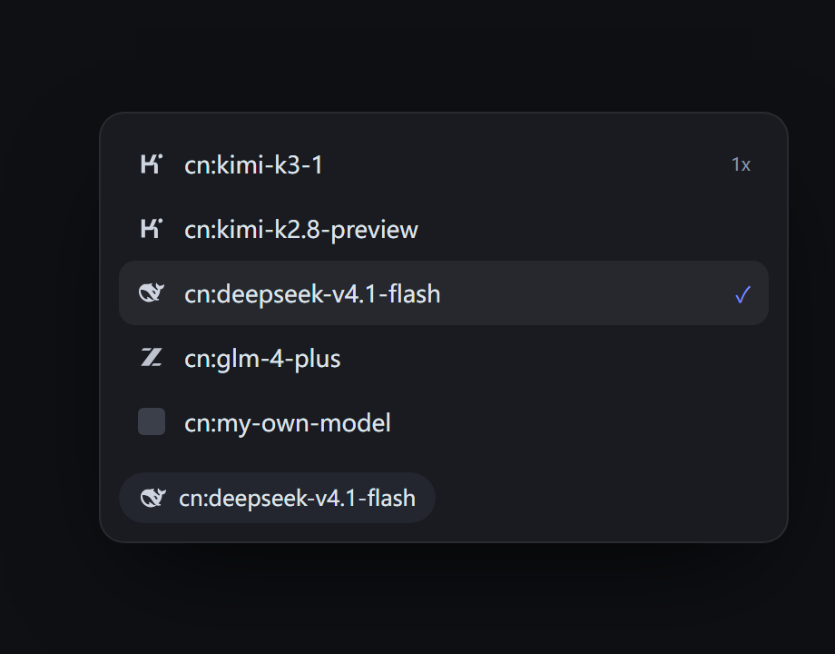

# WorkBuddy 模型图标

给 WorkBuddy 的**自定义模型**自动配上官方品牌图标。

新加一个模型，只要名字里带 `kimi`、`deepseek` 这类词，菜单里就会显示对应品牌的 logo——不用挑图、不用配置。

> [!IMPORTANT]
> **项目已停止维护（2026-10-26）：后续不再更新代码、不再跟进客户端版本变化。**
>
> 原因有二：
>
> 1. **注入入口已被封堵** —— WorkBuddy 从 5.9.2 起换了打包方式：前端不再解包到
>    `app.asar.unpacked`，`renderer/index.html` 已不存在；asar 条目带 SHA256 完整性校验，
>    且 `OnlyLoadAppFromAsar` 为开。本项目的安装方式就是往那个 HTML 里插一段加载器，
>    现在已经没有落点，改 asar 会被拒绝启动。
> 2. **个人精力有限** —— 本机自用的小工具，不打算长期跟进客户端每次改版。
>
> 现状：**5.8.3 及更早版本仍可正常安装使用**，代码与 Release 全部保留。
> 5.9.2 及以上装不上——旧安装器找不到入口文件会直接失败，这不是 bug，不必反复重试。
>
> 补一句：插件代码本身在 5.9.2 的包里仍能找到对应类名（结构没改），缺的只是注入通道；
> 但不打算为这一点重写整套加载架构。

> **非官方项目**。与 WorkBuddy / 腾讯无关。它通过修改客户端的一个入口文件注入脚本，
> 可能违反其服务条款，请自行判断。

> ⚡ **Vibe Coding 产物**：本项目为 100% Vibe Coding 协同产物——人类开发者提出架构与业务意图，AI 助手端到端完成逆向分析、DOM 结构测绘、注入方案设计与界面代码编写。



## 支持的品牌

| 关键词（不区分大小写） | 图标 |
|---|---|
| `kimi` / `moonshot` | Kimi |
| `deepseek` | DeepSeek |
| `glm` / `chatglm` / `zhipu` | 智谱 GLM |
| `minimax` / `abab` | MiniMax |
| `hunyuan` / `hy` | 腾讯混元 |
| `claude` / `anthropic` | Claude |
| `gemini` | Gemini |
| `gpt` / `openai` | OpenAI |

认不出来的保持官方默认图标（灰色立方体），不会乱贴。

## 安装

1. 下载 Release 里的 zip，解压到任意目录
2. 双击 `install.cmd`
3. **完全退出 WorkBuddy 再打开**（托盘图标右键退出，只关窗口不够）
4. 点开模型菜单

`install.cmd -Status` 看状态，`install.cmd -Uninstall` 卸载。

## 兼容性

**实测版本：5.8.3（Windows）**

| 版本区间 | 状态 | 说明 |
|---|---|---|
| ≤ 5.3.x | 基本不可用 | 菜单结构差异较大，找不到图标位 |
| 5.4.0 – 5.4.4 | 可能可用 | 相关功能刚落地，结构未稳定 |
| 5.4.5 – 5.8.3 | 可用 | 结构一致，5.8.3 实测通过 |
| 5.9.0 起 | 待验证 | 模型选择器有新增入口，尚未验证 |

匹配**不依赖固定前缀**：`cr-`、`wb-` 或以后换成别的，只要类名 token 以
`-model-selector__item` / `__item-name` / `__item-icon` 结尾就能认出。
图标位里放的是 `<svg>`、`` 还是别的，也不影响。

**失效时的表现**：找不到结构就完全不动 DOM——界面照常，只是没有品牌图标。
不会白屏、不会报错、不会把菜单弄坏。

### 换版本前先自查

`tools/check-compat.ps1` 会扫一遍安装目录，统计关键类名是否还在：

```powershell
.\tools\check-compat.ps1 -AppRoot "D:\你的\WorkBuddy"
```

输出「全部命中」就可以放心装；有缺失就先别装，等适配。

## 它改了什么

```
resources/app.asar.unpacked/renderer/index.html    ← 插一段 200 字节的加载器
resources/wb-model-icons/wb-model-icons.js         ← 新增的脚本
```

脚本运行时只做一件事：找到模型列表里的图标位，把官方默认的灰色立方体换成品牌 SVG。

**图标不是自己画的**——是从客户端自带的 bundle 里提取的官方 SVG 路径，所以和官方图标是同一套，视觉上分不出来。

## 安全边界

说清楚：

- **不联网**、不读对话内容、不采集数据
- 不改 `app.asar` 本体，只改一个 HTML 入口 + 新增一个 js 文件
- **fail-open**：脚本出错时列表照常显示，只是没有图标，不会把菜单弄坏
- 但修改客户端文件本身有风险，客户端更新会覆盖入口，需要重装一次

## 和「思考强度滑条」共存

两个插件互不干扰：

- 滑条改的是思考强度面板，这个改的是模型图标
- 都用同一个加载器机制，但各自插自己的一段、各自删自己的一段
- 卸载任意一个，另一个照常工作

## 工作原理

```
index.html 插加载器 → 加载 wb-model-icons.js
  → MutationObserver 监听 DOM
  → 按类名词根找到模型条目和图标位（不认前缀）
  → 命中关键词就把原图标节点隐藏，并在旁边追加一个自己的 span 放 SVG
```

覆盖三个位置：主列表条目、自定义模型子菜单、输入框右下角的当前模型胶囊。

> 踩过的坑一：类名匹配不能写死前缀。`cr-` 是运行时拼上去的，
> 直接写 `.cr-model-selector__item` 在别的版本里就是空集合——代码不报错，只是什么都不发生。

> 踩过的坑二：**永远不要用 `innerHTML` 改 React 管的节点**。
> 它会把 React 自己的子节点销毁，之后 React 更新时找不到要删的节点，
> 直接抛 `Failed to execute 'removeChild' on 'Node'`，整个输入框报错。
> 正确做法是：隐藏原节点 + 追加自己的，只改自己创建的 DOM。

## License

MIT
